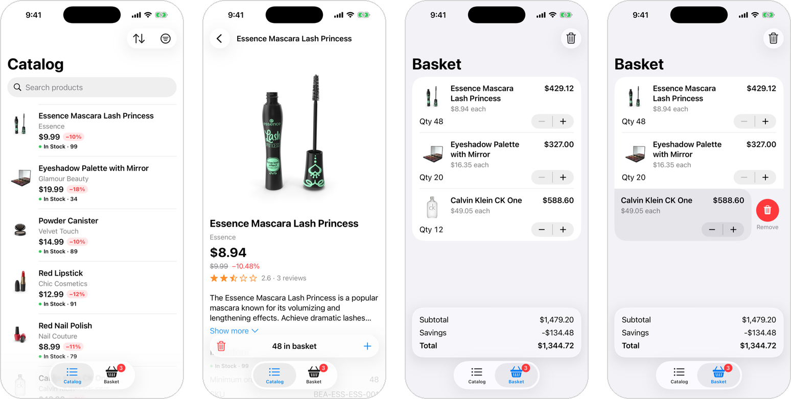

# Product catalog

A small iPhone app, built as the take-home test for FYUL's Senior iOS role.

**The assignment:**
- Build an iOS app on the public [DummyJSON products API](https://dummyjson.com/docs/products) that lists products and opens their details.
- Treat it as something that ships to real users, not a demo.
- Write this one-page README covering the main decisions, what was left out, how we'd know it works for merchants, and how AI was used.

**Who it's for:** merchants who run their business from their phone. They need to check a product's price and stock quickly, find it among hundreds, and put an order together.

*Left to right: the catalog, a product already in the basket, the basket with its totals pinned at the bottom, and removing a line.*

## What it does

- **Browse the catalog.** Every row leads with the price, the discount and how many are in stock, so a merchant can scan for what needs attention. More products load as you scroll.
- **Find a product.** Search the whole catalog, filter by category, or sort by price, name or rating.
- **Open a product.** See its photos, price, rating, description, stock, minimum order and reviews. The page refreshes when it opens, so stock and price are current.
- **Build an order.**
  - Add a product from its page. The app respects each product's minimum order and never lets you order more than is in stock.
  - Once the product is added, the button turns into a quantity control. At the minimum order, the minus becomes a bin that removes the product.
- **Review the basket.**
  - Change quantities, swipe a line to remove it, and see the subtotal, savings and total pinned at the bottom.
  - Tap a line to jump back to its product.
  - The basket is still there after you close the app.
- **Cope with a bad connection.** A slow network shows a hint, failures say what went wrong and offer Retry, and nothing stays stuck loading.

## Try it

Open `Product catalog.xcodeproj` in Xcode 26.6 or later, choose an iPhone simulator and press Run. The first time, Xcode asks to trust the Composable Architecture's macros: choose **Trust & Enable**. No keys or accounts are needed.

⌘U runs the tests. The end-to-end UI test takes about 3 minutes.

To see the error handling without touching your network, add one of these under *Edit Scheme → Run → Arguments*:
- `-scenario offline`: no connection;
- `-scenario slow`: every response takes 4 seconds;
- `-scenario journey`: scripted failures;
- `-scenario large`: 1,200 products.

## Main decisions, and what I considered instead

- **One clear structure for every screen ([The Composable Architecture](https://github.com/pointfreeco/swift-composable-architecture)).** Each screen keeps its state and its work, such as loading and saving, in one place, so its behaviour is easy to test. *Instead:* plain SwiftUI view models. They need less setup, but their loading and error paths are harder to test.
- **Every network call goes through one small gateway.** Tests and demos can replay any situation without the real API: slow, offline, server errors, a product that disappeared. *Instead:* testing against the live API, which can't produce those failures on demand.
- **One basket, shared by every screen and saved on the phone.** The product page, the tab badge and the Basket tab can never disagree. *Instead:* a database (SwiftData), which is more than a short order list needs.
- **Images stay in memory while the app runs.** The image server tells phones not to cache them, and scrolling back shouldn't show blank tiles. *Instead:* an image library, an extra dependency for little gain here.
- **Swift 6 with strict concurrency checks,** so the compiler catches threading mistakes before users do.

The reasoning behind each decision is in [docs/decisions.md](docs/decisions.md), with longer write-ups in [docs/adr](docs/adr). The detailed specification is [docs/specs/product-catalog.md](docs/specs/product-catalog.md).

## Left out, and what's next

- **iPad and foldable layouts.** The app is iPhone only for now. A wider layout becomes due in April 2027, when App Store uploads move to the iOS 27 SDK.
- **Working offline.** Only the basket is saved. The catalog needs a connection, and the app says so clearly when there isn't one.
- **Keeping basket prices fresh.** A basket line keeps the price from when it was added. Next, update it whenever the product is opened.
- **Truly modular packages.** Today one local package holds five modules, and the three screens share one of them. With more time, I'd split them into separate Swift packages, one per layer and one per feature.
- **Out of scope for this test:** checkout, sign-in, translations and analytics.

## How we'd know it works for merchants

The app already logs every request: how long it took and how it ended. Search text stays private, and there's no personal data. Once merchants use it, I'd turn those logs into a few numbers to watch:
- how long it takes to see the first products, and how often the "slow connection" hint appears;
- how often a search ends with a product opened, and how often it finds nothing;
- which errors happen, and how often Retry fixes them;
- how many products get added, and how often stock or a minimum order gets in the way;
- crashes and stutters.

## How I used AI

I worked as the product owner and the reviewer; AI did most of the typing.

- **Tools.**
  - Claude Code ran the project. It interviewed me to turn the brief into a written specification, then split the work into tasks that separate sessions built in parallel.
  - Each feature was checked by an independent reviewer session, which wrote its tests before reading the code.
  - Codex CLI drew the app icon, in FYUL's colours with a TEST ribbon.
- **Where it helped.** It turned a short brief into a precise list of what "done" means. Its reviews also caught real bugs: for example, a "+" typed into search reached the API as a space, and VoiceOver read the quantity twice.
- **Where I changed or rejected it.**
  - I reverted a project-wide threading setting after research showed the architecture library breaks under it.
  - I overruled some of its product ideas, such as sorting by stock and computing its own stock levels, and added the saved basket myself.
  - After using the app on my own iPhone, I redesigned four things:
    - the add-to-basket control, which ignored products already in the basket;
    - the category filter;
    - the basket totals;
    - the module layout, from nine modules down to five.

    That last round went in on the full test suite and a run on my phone rather than separate reviews, to save time.

The rules the AI worked under are in [CLAUDE.md](CLAUDE.md), and the task breakdown is in [docs/tasks](docs/tasks/README.md).
